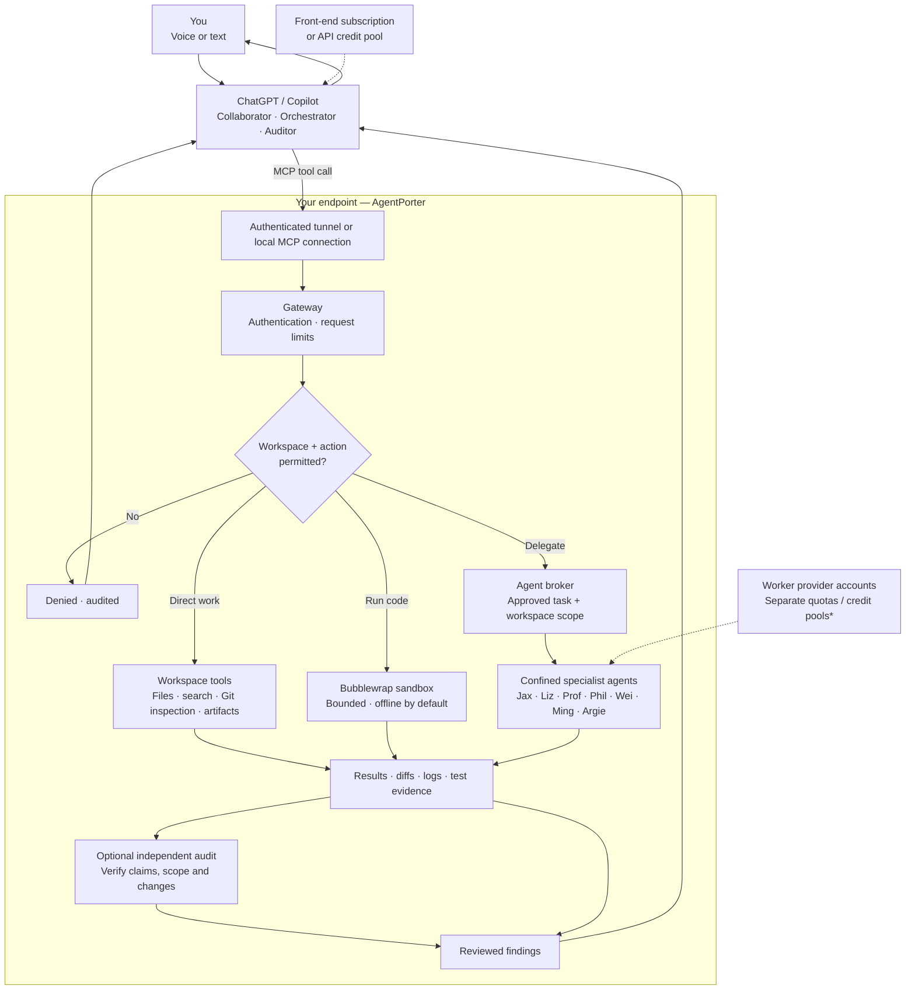

# AgentPorter

**Talk to ChatGPT or Copilot. Work directly in your development environment—or delegate to specialized AI agents.**

AgentPorter is a **local-first AI collaboration, orchestration, and auditing gateway**
for development environments. Through an MCP-capable assistant, you can describe
work in natural language—**including by voice when the client supports it**—and
have that assistant inspect a project, operate approved tools, coordinate coding
agents, review their output, and report back in the same conversation.

**ChatGPT or Copilot is the collaborator, orchestrator, and auditor. AgentPorter
connects it to the endpoint under explicit permissions.** It is not itself a
language model, speech recognizer, SSH login, or unrestricted host shell.
Client-side voice support and connector availability depend on the client.

## Collaborate, delegate, audit

For the Asgard development deployment, see the [A7Dev action map](docs/A7DEV_ACTION_MAP.md)
and [consolidated development status](docs/A7DEV_CURRENT_STATE.md). They distinguish
available operations, workspace grants, technical locks, and pending live checks.

- **Collaborator — work directly:** Inspect registered workspaces; search and
  edit authorized files; run bounded, normally offline tests and scripts;
  inspect Git; and retrieve results and artifacts.
- **Orchestrator — assign specialist work:** Discover configured coding agents,
  delegate scoped tasks, track job status, and bring results back for a
  human-in-the-loop decision. Agent availability and authorization are checked
  independently; naming an agent never guarantees it can run.
- **Auditor — verify independently:** Review diffs, code, logs, test evidence,
  execution metadata, and workspace policy; compare outputs against
  requirements; flag discrepancies, risky actions, and unverifiable claims.
  An audit does **not** grant permissions or replace trusted owner approval.
- **Voice-capable workflow:** With a voice-enabled ChatGPT/Copilot experience,
  ask for an investigation, assign implementation to an approved agent, then
  request a separate review and concise summary. The client owns speech input
  and dialog; AgentPorter handles controlled endpoint access.

### Separate model and credit pools

The **front-end assistant** (for example, ChatGPT or Copilot) and **delegated
coding agents** can use **different subscriptions, API credentials, quotas, or
credit pools**. Delegated work runs under each configured worker CLI/provider
account, not automatically against the front-end chat model's allowance.
Direct filesystem, Git-inspection, and sandboxed-command tools do not by
themselves invoke a separate language model. **Billing depends on actual
provider and account configuration**: AgentPorter neither supplies free
inference nor guarantees that every client/worker has distinct credits.
Check the provider's current plan and usage accounting.

## Workflow and infrastructure

The diagram follows one request from voice or text through a **single
permission-controlled endpoint**. The assistant can work directly, delegate
to another model, and optionally audit the evidence before reporting back.



*Separate billing is configuration-dependent: AgentPorter does not itself
provide inference or guarantee different credits for every agent.*

**Security boundary:** The diagram shows **permitted paths**, not unconditional
capabilities. Direct tools, writable delegation, Git publication, outbound
network access and independent owner approvals remain subject to deployed
release and operator policy. The audit step reviews evidence; it cannot
self-authorize a protected operation.

An endpoint can be a personal workstation or a remote Linux host where
AgentPorter is installed; the MCP client does not need a general-purpose
SSH session. Multiple deployments can use separate gateways, workspace
registries, authentication material, and release cycles.

### Client and transport boundaries

- **MCP over HTTP:** AgentPorter normally listens on `127.0.0.1`; external
  connectivity is opt-in through a properly configured and authenticated
  tunnel or reverse proxy. HTTPS transport alone is not a workspace grant.
- **OpenAI secure-tunnel pattern:** A local tunnel client can authenticate to
  its control plane and inject an AgentPorter Bearer header when forwarding to
  a loopback MCP listener. The chat UI may say “No authentication” for that
  *connector* while AgentPorter still authenticates downstream requests.
  Remote account/tunnel permissions remain a separate security boundary.
- **Public reverse-tunnel pattern:** A publicly reachable forwarding URL can
  expose the gateway to anonymous connections at the tunnel layer, but
  protected tools must still require AgentPorter authentication. A URL alone
  is not authorization. Public health/docs endpoints may be intentionally
  exempt; minimize exposed services.
- **Separate environments:** Development and production should have distinct
  immutable releases, service identities, listeners, policies, credentials, and
  rollout/rollback procedures. Moving a Git folder does not constitute safe
  production promotion.

## Security model

Security is enforced **at the endpoint**, not merely by a client asking for
permission before issuing a call.

1. **Authentication and input checks:** API-key/Bearer validation, allowed
   hosts, request-size budgets, and rate limiting guard protected operations.
2. **Workspace isolation:** Clients select registered workspace IDs, not
   arbitrary host directories. Every file/action is checked against explicit
   permissions and sensitive-path, traversal, and symlink restrictions.
3. **Kernel-constrained execution:** Direct commands use Bubblewrap with
   limited mounts, scrubbed environment, private temporary storage, bounded
   runtime/output, and network isolation by default. Separate operator-approved
   fixed-function egress may exist for narrowly scoped use cases; this does
   not turn generic shell access into unrestricted internet access.
4. **Delegated-worker confinement:** Coding agents need verified confinement,
   limited project roots, controlled credential visibility, and restricted
   network routes. Availability, successful provider authentication, quota,
   and ability to delegate are **different** status checks; unsupported or
   unsafe launch paths must fail closed.
5. **Protected publication and changes:** Git commit/push, deployment, remote
   transfer, and other high-impact actions require server-trusted authorization
   and appropriate backend enforcement. Conversation text or client “Always
   ask” prompts cannot themselves create independent approval receipts.
   Do not interpret the presence of a tool as proof it is enabled.
6. **Auditable outcomes:** Record bounded, sanitized job results, permissions,
   release provenance, and verification evidence. A reviewer should distinguish
   observed behavior from worker claims or configured model names. Never put
   credentials or private machine-specific configuration in public reports.
7. **Human/service file collaboration:** Shared-workspace file writes must
   preserve appropriate owner/ACL access for intended collaborators while
   keeping secrets and protected runtime files private. Check actual deployed
   behavior rather than assuming a source fix has been activated.

The reusable repository documents **security mechanisms and intended policy**.
Some features are experimental, selectively enabled, or unavailable in a given
installation. Development readiness does not imply production activation.
See [SECURITY.md](SECURITY.md), the
[security model](docs/security-model.md), and
[deployment verification](docs/deployment.md).

## Current capabilities

- **Registered-workspace access:** File reads, writes, patches, search, and
  artifact retrieval under per-workspace policy and size bounds.
- **Offline-by-default direct execution:** Bubblewrap confinement for Bash,
  Python, R, and other installed tools, with bounded synchronous/async jobs.
- **Git inspection and policy-gated mutations:** Status, diff, log and show;
  write/publication tools are subject to separate grants and gates.
- **Scoped integrations:** Exact loopback port allowlists and optional
  approved fixed-function HTTPS operations, not generic public shell egress.
- **Named agent discovery and task delegation:** Runtime and OS-confinement
  checks for configured CLIs; read-only by default and writable only where
  explicitly authorized.
- **Audit-friendly provenance:** Deployment fingerprints, job outputs,
  permission failures, and a distinction between configured models and
  independently verified runtime identity.

## Desired action authorization matrix

**Target policy, not the current production permission state.** The owner
can override the initial mode of **every intentionally exposed action**. An
override may enable a less restrictive workflow only when the necessary
technical enforcement exists; it can never disable workspace containment,
network/credential isolation, or required independently verifiable approval.
No new action is implicitly allowed. Changes must come from an authenticated,
audited operator control plane outside agent-writable repositories—not from an
agent, a chat prompt, or a writable project file.

| Target mode | Meaning | Normal owner interaction |
| --- | --- | --- |
| **ALLOW** | Read-only or bounded inspection in an already authorized workspace | No additional AgentPorter confirmation |
| **SCOPE** | Mutations or execution restricted to the approved workspace, files, agent, task and duration | Specify task/scope; explicit write authorization |
| **APPROVAL** | Remote, publication, transfer or high-impact actions with an exact one-time signed owner approval | Review operation details and confirm through a trusted channel |
| **LOCKED** | Owner-selectable temporary disable for *any exposed action* | Reject until the owner changes policy and backend prerequisites are met |

The desired initial modes for all **53 exposed MCP actions** are below.
These are *recommended defaults*, not permanent privilege ceilings.

| MCP action | Desired default | Scope or approval boundary |
| --- | --- | --- |
| `get_capabilities` | **ALLOW** | Read server capabilities, not a permission grant. |
| `server_deploy_info` | **ALLOW** | Read live release provenance only. |
| `list_workspaces` | **ALLOW** | Return IDs and status; no new access. |
| `workspace_info` | **ALLOW** | Use registered workspace only. |
| `list_agents` | **ALLOW** | Expose seven named identities; never promise available. |
| `list_files` | **ALLOW** | Registered workspace; existing sensitive-path protections. |
| `search_text` | **ALLOW** | Sensitive-path filters remain mandatory. |
| `read_file` | **ALLOW** | Sensitive-path filters and file-size caps apply. |
| `list_artifacts` | **ALLOW** | Registered workspace and artifact controls. |
| `read_artifact` | **ALLOW** | Registered workspace and response limits. |
| `git_status` | **ALLOW** | No changes to repository. |
| `git_diff` | **ALLOW** | No changes to repository. |
| `git_log` | **ALLOW** | No changes to repository. |
| `git_show` | **ALLOW** | No changes to repository. |
| `git_branch` | **ALLOW** | List only, not checkout. |
| `job_status` | **ALLOW** | Existing job ID; no mutation. |
| `job_output` | **ALLOW** | Existing job ID; bounded output. |
| `job_result` | **ALLOW** | Existing job ID; bounded output. |
| `venkata_diagnostic` | **ALLOW** | Fixed allowlisted diagnostic; no arbitrary SSH. |
| `scinet_diagnostic` | **ALLOW** | Fixed allowlisted diagnostic; no arbitrary SSH. |
| `scinet_job_status` | **ALLOW** | Job ID scoped to approved submission. |
| `scinet_job_logs` | **ALLOW** | Bounded output; approved job only. |
| `scinet_setup_status` | **ALLOW** | Read setup state only. |
| `scinet_inference_preflight` | **ALLOW** | Offline verification; no submission. |
| `scinet_inference_results` | **ALLOW** | Ledger-bound read; fails closed when unsupported. |
| `scinet_preflight` | **ALLOW** | Read-only validation. |
| `scinet_environment_check` | **ALLOW** | Fixed environment check. |
| `write_file` | **SCOPE** | Explicit writable workspace, allowed path, reversible diff. |
| `apply_patch` | **SCOPE** | Explicit writable workspace, patch review. |
| `mkdir` | **SCOPE** | Explicit writable workspace/path. |
| `move_path` | **SCOPE** | Explicit writable workspace; conflict guard. |
| `trash_path` | **SCOPE** | Recoverable trash only; no permanent delete. |
| `exec_run` | **SCOPE** | Bubblewrap commands remain offline; a separately operator-approved cranary GET/HEAD metadata broker is proposed, without generic shell internet access. Arbitrary commands may write workspace content; future scope gate required. |
| `exec_start` | **SCOPE** | Offline-by-default; proposed owner-approved metadata requests use a fixed-function supervised HTTPS worker with bounded lifetime. |
| `job_cancel` | **SCOPE** | Only authorized job; report actual cancellation state. |
| `git_add` | **SCOPE** | Stage only exact approved paths; no commit. |
| `git_checkout` | **SCOPE** | Only approved branch/worktree, inspect dirty changes before switch. |
| `dispatch_agent` | **SCOPE** | Only one of seven named IDs; default read-only; scoped write opt-in. |
| `local_http_request` | **APPROVAL** | Explicit port + method + body review; loopback can mutate services. |
| `venkata_transfer` | **APPROVAL** | Approved file hashes and fixed destination; data exfiltration risk. |
| `scinet_login` | **APPROVAL** | Human performs Duo; caller cannot approve for human. |
| `scinet_stage` | **APPROVAL** | Approved digest, destination, size budget. |
| `scinet_submit` | **APPROVAL** | Approved template, allocation budget, reviewer. |
| `scinet_setup` | **APPROVAL** | Fixed verified setup template, staged artifact. |
| `scinet_inference_stage` | **APPROVAL** | Approved exact bundle digest to fixed scratch. |
| `scinet_inference_provision` | **APPROVAL** | Remote inference environment provisioning; exact manifest/digest and authorized path, never unreviewed installation. |
| `scinet_inference_approve` | **APPROVAL** | Verify offline independent signature; do not self-approve. |
| `scinet_inference_submit` | **APPROVAL** | Signed exact stage + allocation quota. |
| `git_fetch` | **APPROVAL** | Remote-only plus workspace metadata change; no read-only fetch. |
| `git_pull` | **APPROVAL** | Branch and remote explicit, clean-tree and conflict checks. |
| `git_commit` | **APPROVAL** | Publication by a separate verified publisher, bound to a reviewed tree/remote/ref; currently technically disabled. |
| `git_push` | **APPROVAL** | Publication by a separate verified publisher, bound to a reviewed tree/remote/ref; currently technically disabled. |
| `scinet_record_approvals` | **APPROVAL** | Existing per-stage, per-experiment fixed-reviewer confirmation mechanism; never treat speech or worker text as human approval. |

**Important deployment distinctions:** The matrix describes **desired**
authorization modes, not a live capability guarantee. Git publication,
network-capable Git operations, trusted owner approvals, and writable worker
dispatch depend on the specific installed release and operator policy.
A development deployment may have verified OS-confined worker delegation
while production is still blocked. The `action-policy.yaml` configuration
alone does not create a trusted approval issuer or safe permission escalation.
Check live tool permissions, deployment provenance, and the operator's actual
policy before attempting any state-changing action.

### Capabilities intentionally *not* exposed

Unrestricted host shell/SSH, `sudo`, `systemctl`, service restarts,
OS/package and account administration, credential export, unreviewed
AgentPorter deployment, destructive Git history rewriting/`push --force`,
and approval forgery are **not MCP/REST actions** and cannot be enabled
through a policy override. Blocking only a tool name is insufficient:
generic execution and delegated workers must also be kernel-confined
against indirect access.

### Two independent authorization layers

1. **ChatGPT → a7 connector:** The ChatGPT tool permission setting controls
   when the client asks before sending a tool call. It does not issue
   trusted AgentPorter approval receipts.
2. **AgentPorter → local tool/worker:** Workspace permissions, the operator
   action matrix, isolated execution, scoped grants and one-use approvals
   determine whether the requested operation may actually execute.
   An instruction by voice may request an override; it cannot itself mint
   a verified approval.

Seven named public worker identities are **Jax, Liz, Prof, Phil, Wei, Ming,
and Argie**; generic adapter runtimes are not additional user-selectable
agents, and Tracker is excluded. Runtime availability is checked separately
from registration or policy eligibility.

See the [complete roster and current-mode inventory](docs/agent-roster-action-policy.md)
and [authorization implementation design](docs/action-authorization-design.md).

## Trust boundaries

Direct code execution uses Bubblewrap isolation. **Delegated coding agents
are a separate trust boundary:** a development deployment can use a verified
confined worker launcher, while other releases or agents may remain blocked.
Older host-user adapters must not be assumed safe merely because they are
visible in the roster. Confirm live `confinement_status`, policy eligibility,
and per-workspace admission before dispatch; read-only access cannot be
upgraded by the agent's own request.

See [SECURITY.md](SECURITY.md).

## Status

**Early alpha / active dogfooding.** Features vary by deployment; examples
and desired policy should not be confused with production readiness.

"Dogfooding" means using your own product for real work while it is still under
development. The purpose is to discover failures, awkward interfaces, missing
controls, and real security requirements before designing features speculatively
or releasing broadly.

Current platform target: Linux and WSL2 with Python 3.11+ and Bubblewrap.

## Install

```bash
git clone https://github.com/lennon-li/AgentPorter.git
cd AgentPorter
pip install -e ".[dev]"
```

AgentPorter is not published to PyPI yet.

## Configure

Create `~/.config/agentporter/workspaces.yaml`:

```yaml
workspaces:
  my-project:
    path: /home/user/projects/my-project
    writable: true
    allow_execute: true
    allow_git: true
    allow_artifacts: true
    allow_agent_dispatch: false
    local_http_ports: []
```

The default server configuration binds only to localhost and uses the
`X-AgentPorter-Key` API-key header. On first startup, AgentPorter generates a
key in `~/.config/agentporter/secrets.env` with restrictive permissions.

## Run

```bash
agentporter doctor
agentporter serve --host 127.0.0.1 --port 8765
```

## Documentation

- [Architecture](docs/architecture.md)
- [Public ingress patterns](docs/public-ingress.md)
- [OpenAI secure MCP tunnel setup](docs/openai-tunnel-setup.md)
- [Security model](docs/security-model.md)
- [Package vs. local separation](docs/package-vs-local.md)
- [Local setup](docs/local-setup.md)
- [Deployment and verified activation](docs/deployment.md)
- [MCP clients](docs/mcp-clients.md)
- [ChatGPT access through an OpenAI Secure MCP Tunnel](docs/openai-tunnel-setup.md)
- [Knowhere AgentPorter and ChatGPT setup runbook](setup.md)
- [Worker delegation guide](docs/delegation-guide.md)
- [Named-agent roster and action authorization matrix](docs/agent-roster-action-policy.md)
- [Owner approval, overrides and sandbox design](docs/action-authorization-design.md)
- [AgentPorter branch/worktree cleanup and recovery manifest](docs/repository-cleanup-20261019.md)
- [Microsoft Copilot Studio](docs/copilot-studio.md)
- [Roadmap / TODO](TODO.md)

## Development

```bash
pytest -v tests/
```

The repository intentionally does not choose a public software license yet.
